<p align="center">
  
</p>

<h1 align="center">mods-marketplace</h1>

<p align="center">
  <b>Make Claude Code feel alive.</b><br>
  Three pixel-art mods that show you what's happening under the hood: how warm your prompt cache is, what your subagents are up to, and how good your brief really was.
</p>

<p align="center">
  <a href="#install-in-30-seconds">Install</a> ·
  <a href="#cache-thermo">cache-thermo</a> ·
  <a href="#agent-den">agent-den</a> ·
  <a href="#prompt-coach">prompt-coach</a> ·
  <a href="LICENSE">MIT</a>
</p>

---

Claude Code does a lot you never see. Your cache quietly goes cold while you get coffee, and the next prompt pays to rebuild it. Five subagents run in parallel, and all you get is a spinner. A vague prompt costs you three rounds of fixes later.

These mods put all of that on screen in a calm pastel-on-dark style, with hand-drawn pixel mascots that react to what's happening. They work in the terminal (with ASCII art), in Claude Code Desktop and in VS Code.

## Install in 30 seconds

Pick the mods you want. At the prompt of a Claude Code session:

```
/plugin install cache-thermo --marketplace stilero/mods-marketplace
/plugin install agent-den    --marketplace stilero/mods-marketplace
/plugin install prompt-coach --marketplace stilero/mods-marketplace
```

From a shell:

```bash
claude plugin install cache-thermo --marketplace stilero/mods-marketplace
```

In Claude Code Desktop, click `+` next to the prompt box, choose **Plugins → Add marketplace**, enter `stilero/mods-marketplace`, then **Add plugin**.

---

## cache-thermo

**Never pay for a cold cache by surprise again.**



A retro thermometer sits above your prompt and counts down the cache TTL. It's mint while the cache is hot, honey as it cools, and rose once it's cold. Ember the fire sprite keeps you company.

- **Cold-cache gate.** If you send an expensive prompt into a cold cache, Frostbit the ice imp holds it and shows the re-cache cost first. You can go ahead or keep your prompt.
- **Break mode.** Hit `☕ break` and Ember sits by the campfire, refreshing the cache with a tiny cache-read request just before it expires. When you come back, it's still warm.
- **Toasts and 8-bit bleeps** when the cache cools and goes cold.

[Read more →](plugins/cache-thermo/)

## agent-den

**Your subagents, as a den of tiny pixel friends.**



Each subagent gets its own animated buddy: Digby the mole digs through your Explore agents, Bricks the beaver builds your plans, and Bristle the hedgehog reviews your code. You can see at a glance who's busy, waiting, napping, done or in trouble, and which tool each one is running right now.

- **Ten buddies**, each with a loop for every status and one-shot animations for hatching, finishing and failing.
- **Click a buddy** to open its tool calls and output in a second pane.
- **Child agents** show up under their parents. A status line shows the totals: `🐾 2 busy · 1 napping · 3 done`.

[Read more →](plugins/agent-den/)

## prompt-coach

**Better briefs, fewer rounds of fixes.**



Quill, a little owl with reading glasses, reads the prompt that starts a piece of work and checks it for the five parts of a good brief: **goal, why, constraints, done-when and reuse**. A small model decides which parts actually apply, so a bug fix isn't asked for a backstory.

- **Hints mode** sends your prompt right away and coaches you for next time.
- **Gate mode** holds a weak brief and lets you improve it, send it anyway, or let Claude ask you the missing questions.
- **It doesn't nag.** It reads the first task prompt of each conversation and tracks how your briefs improve over time.

[Read more →](plugins/prompt-coach/)

---

## Hacking on the mods

Each mod is a function-hooks plugin under [`plugins/`](plugins/), and this repo is the marketplace. To work from a local checkout:

```bash
claude plugin marketplace add /path/to/mods-marketplace
claude plugin install cache-thermo@mods-marketplace
```

A plugin installed from a folder marketplace is read live from that folder, so you can edit and then run `/reload-plugins`. To try a mod for a single session, run `claude --plugin-dir plugins/cache-thermo`.

Validate before committing:

```bash
claude plugin validate .
for mod in cache-thermo prompt-coach agent-den; do
  claude plugin validate plugins/$mod && claude plugin test plugins/$mod
done
```

The README images are built from the mods' own `hooks/art.ts`, so they match what the mods draw. Regenerate them after changing any art with `node scripts/build-readme-art.mjs` (requires Node 23.6 or later).

## License

[MIT](LICENSE). You're free to use, modify and share the mods, as long as the copyright notice stays with them.
