# model-advisor

A Claude Code mod that helps you run each piece of work on the lowest model and effort that will do it well. Cog, a little pixel robot with a screen on its belly, weighs the prompt that starts your work. If the session runs on more model or effort than the work needs, Cog holds the prompt and asks you first. If the work needs more than the session has, Cog tells you that too.



## What you get

- **Gate mode** (default). A prompt that fits another model or effort waits in the band above the prompt until you pick:
  - **use …** (`s`): Cog runs `/model` and `/effort` for the advised setup, then sends your prompt as typed.
  - **send anyway** (`a`): the prompt goes as typed, on the setup that the session has.
  - **keep my prompt** (`x`): the prompt comes back to the prompt box. Nothing is sent.

  A prompt that fits the setup goes straight through with a short toast.
- **Hints mode**. The prompt is sent at once. When Cog finishes, the band shows the advice with a **use … next** button for the prompts that follow.
- **Both directions**. A mint arrow down means that a lower setup is enough. A lavender arrow up means that the work needs more.
- **Not spammy**. Cog weighs the first prompt of each conversation: at session start, after `/clear` and after a compaction. `/model-advisor next` asks for one more read. Greetings, follow-ups ("yes, continue") and short prompts are not weighed.
- **A little progress line**: how many prompts Cog weighed and how many shifts you took, kept across sessions.

### Why the first prompt

A model switch in the middle of a conversation makes the next request write the prompt cache again. At the start of a conversation there is nothing in the cache, so a switch costs nothing. This is why the default is the first prompt. If you set **When to advise** to `every`, the band says when a switch re-caches the conversation. [cache-thermo](../cache-thermo/) shows what that costs.

## How Cog decides

A small model (Haiku by default) reads the prompt as data and rates the work. It then names the lowest model and effort that will do the work well.

| Complexity | Examples | Typical advice |
|---|---|---|
| trivial | a typo, a rename, a one-line edit, a short factual question | `haiku · low` |
| simple | a change in one or two files, a small script, one unit test | `sonnet · low` |
| moderate (shown as "everyday") | a typical feature or bug fix across a few files | `sonnet · medium` |
| complex | a feature across modules, a hard bug with an unknown cause, architecture | `opus · high` |
| deep | a large migration, security- or concurrency-critical work, long autonomous work | `fable · xhigh` or `max` |

The mod then compares the advice with the setup of the session:

- A different model on the ladder gives advice. The advised effort goes with it.
- The same model gives advice only when the effort is more than **Effort tolerance** levels from the advised effort (default 1).
- A model that is not on the ladder gets no model advice.
- An effort that the mod cannot read is not advised alone. The mod reads the effort from the last request of the session, a typed `/effort` or the saved `effortLevel` setting.
- If `CLAUDE_CODE_EFFORT_LEVEL` names the effort, `/effort` cannot change it for the session. Cog then advises the model only.

One read costs about 1,200 input tokens and 100 output tokens on Haiku and takes about one second (measured on Claude Code 2.1.322). In gate mode the prompt waits for that second.

## The band and the pane

Cog draws in the band above the prompt, as the cold-cache gate of cache-thermo does. Only one mod can draw that band at a time, and the mod that you installed first keeps it. If the band does not show the advice after 0.7 seconds (another mod has the band, or you collapsed it), the **Model advisor** pane opens with the same picture and the same buttons. The pane closes when you pick. `/model-advisor switch`, `send` and `keep` do the same as the buttons.

### In the terminal

The look follows [cache-thermo](../cache-thermo/) and [prompt-coach](../prompt-coach/): calm mint, honey and lavender on a dark panel, round borders, animated pixel art on the desktop and in VS Code, and two-frame ASCII in the terminal:

```
  _i_      _*_      _i_      _i_      _i_
 [o o]    [< <]    [o o]    [o o]    [^ ^]
 /[=]\    /[^]\    /[v]\    /[^]\    /[+]\
 idle    reading   down      up       fit
```

## Install

At the prompt of a terminal session:

```
/plugin install model-advisor --marketplace stilero/mods-marketplace
```

From a shell: `claude plugin install model-advisor --marketplace stilero/mods-marketplace`. In Claude Code Desktop: `+` next to the prompt → Plugins → Add marketplace → Add plugin.

## Commands

| Command | Effect |
|---|---|
| `/model-advisor` | One-line status: mode, whether the next prompt will be weighed, the setup of the session, the ladder, your stats |
| `/model-advisor next` | Weigh the next prompt, whatever the trigger |
| `/model-advisor switch` / `send` / `keep` | The three choices of the gate, for a prompt that waits |
| `/model-advisor open` | Open the Model advisor pane |
| `/model-advisor mode gate` / `hints` / `off` | Switch mode for this session; the setting below stays the default |

## Configuration (`/config` rows)

| Field | Default | Purpose |
|---|---|---|
| Mode | `gate` | `gate` holds a prompt that fits another setup; `hints` sends at once and shows the advice for the next prompt |
| Gate on | `both` | Which advice holds the prompt: `both`, only `down` (a lower setup is enough) or only `up` (the work needs more). The other advice shows as a hint |
| When to advise | `conversation` | `conversation`: the first prompt of each conversation. `every`: every prompt typed while Claude is idle (one small model call for each prompt) |
| Advisor model | `haiku` | The model that weighs the prompt: an alias or a full model id |
| Model ladder | `haiku,sonnet,opus,fable` | The models Cog can advise, from the cheapest to the most capable, as `/model` takes them. Remove the models that your account cannot use |
| Effort tolerance (levels) | 1 | An effort at most this many levels from the advised effort is left alone. 0 advises on every difference |
| Minimum prompt length | 20 | Shorter prompts are never weighed |

## How it works

- `prompt.submit` skips slash commands, meta prompts, prompts typed while a turn runs, prompts that no person wrote (notifications, scheduled tasks, other sessions) and short prompts. When Cog is armed it calls `$.model.complete` with a fixed rubric (`hooks/advise.ts`). The prompt is fenced as data, and the reply is strict JSON: `isWork`, a complexity, a model from the ladder, an effort, a headline and a reason.
- `decide` in `hooks/advise.ts` compares the reply with the session's model (`$.session.model()`) and effort. It is pure code, so the same reply always gives the same advice.
- Gate mode awaits the read and returns `{ drop }`. The text stays in plugin state until a button resubmits it with `$.prompt.submit({ asUser: true })` or hands it back with `$.prompt.fill`. Hints mode does not await the read.
- The switch runs the built-in commands with `$.command.run`: `/model <name>`, then `/effort <level>`. It is the same switch as when you type them, so Claude Code decides if it is saved as your default. If a command fails, the prompt goes back to the prompt box and a toast names the commands to type.
- A failed or unparseable read fails open: the prompt goes through, a toast says so, and Cog disarms until the next conversation.
- A prompt with attachments is never held (a resubmit cannot carry them): it gets the hint. A run that draws nothing (`claude -p`, an SDK host with no surface) is never held and never weighed.
- Arming lives in `$.state`: set on a fresh `session.start`, on `session.end` with reason `clear`, and on a main-thread `session.compact`; cleared once a prompt has been weighed.
- Stats live in `$.store` under `stats`.

## Development

```bash
claude plugin validate plugins/model-advisor
claude plugin test plugins/model-advisor
(cd plugins/model-advisor && node scripts/build-preview.mjs)   # writes scripts/preview-art.html
```

Run `claude --plugin-dir plugins/model-advisor` to try it in one terminal session.
